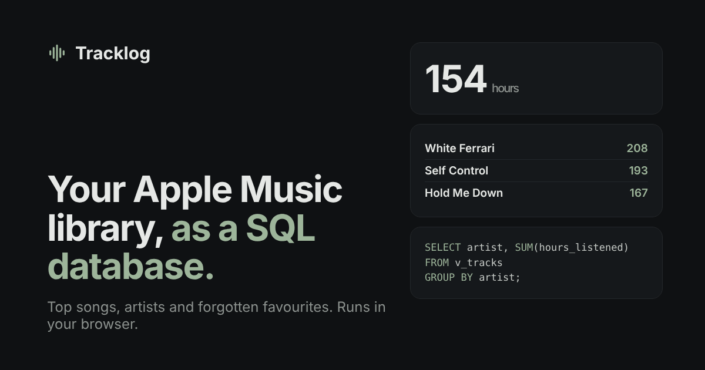

# Tracklog

**Turn your Apple Music or Spotify library into a SQL database, see your listening habits, and blend libraries with friends across both services, all inside your browser.**

**[Try it live →](https://matthewtang29.github.io/Tracklog/)**

<!-- DEMO GIF: record ~10 seconds (upload Library.xml → dashboard fills in → run a query in the SQL console),
     save it as docs/demo.gif, and change the image below to docs/demo.gif. -->


## Features

- **Apple Music and Spotify.** Drop in the `Library.xml` you export from the Music app or iTunes, the `.json` files from your Spotify data download, or both. Several files load at once. Spotify plays of a song you also have in Apple Music are added to the same song, so someone who switched services sees one combined history.
- **Blend, across platforms.** Load a friend's files (or several friends') and the Blend card works out a taste match for each pair, the artists you share, and a 30-song mix that takes turns between songs you both play and each person's picks. It works between an Apple Music listener and a Spotify listener, which Spotify Blend and Apple's shared playlists can't do. Every number comes from a query in `sql/queries/blend_*.sql`.
- **A sample to try first.** Two sample listeners load on the first visit: Alex (an Apple Music library) and Sam (a Spotify download), so the Blend has someone to compare.
- **A dashboard where every card is a SQL query.** You get total hours, top songs and artists, playlists, genres, forgotten favourites, most skipped songs and songs added per month. Click "Show SQL" on any card to read the query behind it.
- **Pick Me a Song.** Answer three questions (an old favourite, something forgotten or a song you barely play; a vibe taken from your own playlists or genres; safe or brave), or press Surprise me. The answers fill in the named parameters of one query, `sql/queries/suggest.sql`, which scores your songs. The page picks one of the top 20 at random, avoids repeats, and says why it chose it. If nothing matches, it loosens one answer and tells you which.
- **A SQL console.** Write your own queries against your own library, or start from six example queries.
- **Album covers.** Library exports contain no images, so covers are matched through Apple's iTunes Search with careful matching rules, caching and rate-limit backoff. This only happens if you say yes.
- **Private by design.** There's no server and no account. Your files are read in your browser and never uploaded.
- **Handles real-world files.** A streaming parser in a Web Worker reads a 150 MB, 250,000-song export without freezing the page. Damaged files get a clear message instead of a crash.

## Tech stack

| Piece | What I used |
|---|---|
| Database | SQLite in the browser via [sql.js](https://github.com/sql-js/sql.js) (self-hosted, runs in a Web Worker) |
| Parsing | A small streaming plist (XML) parser I wrote for Apple's export format, and a reader for Spotify's streaming-history JSON |
| Front end | Plain HTML, CSS and JavaScript (ES modules). No framework, no build step |
| Album art | Apple's public iTunes Search API |
| Hosting | GitHub Pages |

## Why I built it

I wanted a project that showed real SQL skills on data I actually care about. Apple Music doesn't give you much: no all-time stats, and nothing like Spotify Wrapped on demand. It *does* let you export your whole library, with every song's play count, skip count, date added and last played.

So I asked: what if that file became a proper relational database, and every number on the page was a SQL query you could read? The schema is normalized (`artists → albums → tracks`, plus a many-to-many `playlist_tracks` table). The queries use joins, CTEs, window functions (`ROW_NUMBER`, `RANK`, `SUM() OVER`), date functions and a named `:export_date` parameter. That way "six months ago" means six months before *your* export, not today.

For example, here's each playlist's most-played song in one pass:

```sql
WITH ranked AS (
  SELECT p.name AS playlist,
         v.title || ' – ' || v.artist AS top_song,
         ROW_NUMBER() OVER (PARTITION BY p.playlist_id ORDER BY v.play_count DESC) AS rn,
         SUM(v.play_count) OVER (PARTITION BY p.playlist_id) AS plays
  FROM playlists p
  JOIN playlist_tracks pt ON pt.playlist_id = p.playlist_id
  JOIN v_tracks v ON v.track_id = pt.track_id
)
SELECT playlist, plays, top_song FROM ranked WHERE rn = 1 ORDER BY plays DESC;
```

## How it works

```
Library.xml ─┐
             ├─► readers (worker) ─► one SQLite database for everyone ─► one SQL query per card ─► charts
Spotify .json┘
```

1. **Reading.** `js/worker.js` reads Library.xml in chunks with `js/plist.js`, so the page stays responsive and shows progress. Spotify files go through `js/spotify.js`, which recognises each file by its contents (lifetime or past-year streaming history, Liked Songs, playlists) and ignores the rest of the download. Spotify only lists streams, so a stream of 30 seconds or more counts as a play and a shorter one as a skip. The two histories overlap, so each stream is counted once. Every field is type-checked. One damaged song gets skipped, not the whole file.
2. **Matching.** Each song gets a `song_key`: its title without "(feat. …)" or "- Remastered" and its main artist, lower-cased and without accents. That's how the same song lines up across Apple Music and Spotify, inside one person's library and between people in a Blend. Artists are matched on their main name the same way.
3. **Building.** The worker inserts everyone's songs, artists, albums and playlists into the schema in `sql/schema.sql`, inside one transaction that rolls back if anything fails. `tracks`, `v_tracks` and `playlists` are views that show the person you're viewing, so every card query works unchanged for each person. `all_tracks` holds everyone for the Blend.
4. **Querying.** Each card runs one query from `sql/queries/`. Console queries that run longer than 10 seconds are stopped.
5. **Rendering.** `js/render.js` turns results into ranked lists, bars and tables. All text goes in with `textContent`, never as HTML.

**Privacy and security.** A strict Content-Security-Policy only allows this site and Apple's search and image hosts. The font and SQLite engine are self-hosted, so no request goes to Google or a CDN. A "Clear saved covers & settings" button removes everything Tracklog stores in your browser. See [privacy.html](privacy.html).

## Run it locally

The page loads its `.sql` files and the worker with `fetch`, which browsers block when you double-click `index.html`. Start a small local server in the project folder instead.

**Mac** (Terminal):

```bash
cd path/to/Tracklog
python3 -m http.server 8000
```

**Windows** (PowerShell or Command Prompt):

```bash
cd path\to\Tracklog
py -m http.server 8000
```

Then open http://localhost:8000.

To get your library files:

- **Mac:** Music app → File → Library → Export Library…
- **Windows:** iTunes → File → Library → Export Library…
- **Spotify:** your account's Privacy page → Download your data. Ask for Extended streaming history (all years) and/or Account data (past year, Liked Songs, playlists). Unzip what Spotify emails you and upload the `.json` files.

## Project structure

```
Tracklog/
├── index.html               the app
├── 404.html, privacy.html, terms.html
├── css/styles.css           styling (neutral palette, one accent for the main action)
├── js/
│   ├── main.js              starts the app, draws each card, uploads, people, SQL console
│   ├── database.js          loads the .sql files; talks to the worker
│   ├── worker.js            reads everyone's files, builds SQLite, runs queries (off the main thread)
│   ├── plist.js             streaming parser for Apple's plist XML
│   ├── spotify.js           reads Spotify's .json files; song keys for cross-platform matching
│   ├── render.js            song lists, artist bars, tables, the monthly chart
│   ├── suggest.js           the Pick Me a Song quiz (weighted random pick, fallbacks)
│   ├── blend.js             the Blend card (taste match, shared artists, mixed playlist)
│   ├── artwork.js           album covers via the iTunes Search API
│   └── sample-library.js    demo listeners (real songs, invented play counts)
├── sql/
│   ├── schema.sql           tables + views (per person and everyone)
│   ├── queries/             one query per dashboard card
│   └── examples/            example queries for the SQL console
└── vendor/                  sql.js 1.12.0 and the Inter font (with their licences)
```

To add a card, write a query in `sql/queries/`, add its name to `QUERY_NAMES` in `js/database.js`, add an element with `data-q="<name>"` to `index.html`, and add a `case` for it in `renderAll()` in `js/main.js`.

## Built with AI pairing

I built Tracklog by pairing with Claude, an AI coding assistant. I decided what the dashboard should say, tested it against my own 697-song library, and pushed back when numbers or covers looked wrong.
