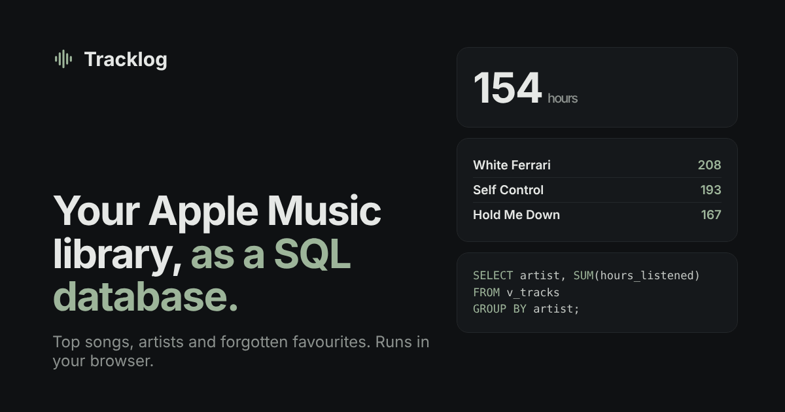

# Tracklog

**Turn your Apple Music library into a SQL database and see your listening habits, all inside your browser.**

**[Try it live →](https://matthewtang29.github.io/Tracklog/)**

<!-- DEMO GIF: record ~10 seconds (upload Library.xml → dashboard fills in → run a query in the SQL console),
     save it as docs/demo.gif, and change the image below to docs/demo.gif. -->


## Features

- **Your stats from your own file.** Drop in the `Library.xml` you export from the Music app or iTunes, or start with the built-in sample library.
- **A dashboard where every card is a SQL query.** You get total hours, top songs and artists, playlists, genres, forgotten favourites, most skipped songs and songs added per month. Click "Show SQL" on any card to read the query behind it.
- **A SQL console.** Write your own queries against your own library, or start from six example queries.
- **Album covers.** Library exports contain no images, so covers are matched through Apple's iTunes Search with careful matching rules, caching and rate-limit backoff. This only happens if you say yes.
- **Private by design.** There's no server and no account. Your file is read in your browser and never uploaded.
- **Handles real-world files.** A streaming parser in a Web Worker reads a 150 MB, 250,000-song export without freezing the page. Damaged files get a clear message instead of a crash.

## Tech stack

| Piece | What I used |
|---|---|
| Database | SQLite in the browser via [sql.js](https://github.com/sql-js/sql.js) (self-hosted, runs in a Web Worker) |
| Parsing | A small streaming plist (XML) parser I wrote for Apple's export format |
| Front end | Plain HTML, CSS and JavaScript (ES modules). No framework, no build step |
| Album art | Apple's public iTunes Search API |
| Hosting | GitHub Pages |

## Why I built it

I wanted a project that showed real SQL skills on data I actually care about. Apple Music doesn't give you much: no all-time stats, and nothing like Spotify Wrapped on demand. It *does* let you export your whole library, with every song's play count, skip count, date added and last played.

So I asked: what if that file became a proper relational database, and every number on the page was a SQL query you could read? The schema is normalized (`artists → albums → tracks`, plus a many-to-many `playlist_tracks` table). The queries use joins, CTEs, window functions (`ROW_NUMBER`, `RANK`, `SUM() OVER`), date functions and a named `:export_date` parameter. That way "six months ago" means six months before *your* export, not today.

For example, here's each playlist's most-played song in one pass:

```sql
WITH ranked AS (
  SELECT p.name AS playlist,
         v.title || ' – ' || v.artist AS top_song,
         ROW_NUMBER() OVER (PARTITION BY p.playlist_id ORDER BY v.play_count DESC) AS rn,
         SUM(v.play_count) OVER (PARTITION BY p.playlist_id) AS plays
  FROM playlists p
  JOIN playlist_tracks pt ON pt.playlist_id = p.playlist_id
  JOIN v_tracks v ON v.track_id = pt.track_id
)
SELECT playlist, plays, top_song FROM ranked WHERE rn = 1 ORDER BY plays DESC;
```

## How it works

```
Library.xml ─► streaming parser (worker) ─► SQLite (worker) ─► one SQL query per card ─► charts
```

1. **Reading.** `js/worker.js` reads the file in chunks with `js/plist.js`, so the page stays responsive and shows progress. Every field is type-checked. One damaged song gets skipped, not the whole file.
2. **Building.** The worker inserts songs, artists, albums and playlists into the schema in `sql/schema.sql`, inside one transaction that rolls back if anything fails.
3. **Querying.** Each card runs one query from `sql/queries/`. Console queries that run longer than 10 seconds are stopped.
4. **Rendering.** `js/render.js` turns results into ranked lists, bars and tables. All text goes in with `textContent`, never as HTML.

**Privacy and security.** A strict Content-Security-Policy only allows this site and Apple's search and image hosts. The font and SQLite engine are self-hosted, so no request goes to Google or a CDN. A "Clear saved covers & settings" button removes everything Tracklog stores in your browser. See [privacy.html](privacy.html).

## Run it locally

The page loads its `.sql` files and the worker with `fetch`, which browsers block when you double-click `index.html`. Start a small local server in the project folder instead.

**Mac** (Terminal):

```bash
cd path/to/Tracklog
python3 -m http.server 8000
```

**Windows** (PowerShell or Command Prompt):

```bash
cd path\to\Tracklog
py -m http.server 8000
```

Then open http://localhost:8000.

To get your library file:

- **Mac:** Music app → File → Library → Export Library…
- **Windows:** iTunes → File → Library → Export Library…

## Project structure

```
Tracklog/
├── index.html               the app
├── 404.html, privacy.html, terms.html
├── css/styles.css           styling (neutral palette, one accent for the main action)
├── js/
│   ├── main.js              starts the app, draws each card, upload + SQL console
│   ├── database.js          loads the .sql files; talks to the worker
│   ├── worker.js            reads Library.xml, builds SQLite, runs queries (off the main thread)
│   ├── plist.js             streaming parser for Apple's plist XML
│   ├── render.js            song lists, artist bars, tables, the monthly chart
│   ├── artwork.js           album covers via the iTunes Search API
│   └── sample-library.js    demo library (real songs, invented play counts)
├── sql/
│   ├── schema.sql           tables + the v_tracks view
│   ├── queries/             one query per dashboard card
│   └── examples/            example queries for the SQL console
└── vendor/                  sql.js 1.12.0 and the Inter font (with their licences)
```

To add a card, write a query in `sql/queries/`, add its name to `QUERY_NAMES` in `js/database.js`, add an element with `data-q="<name>"` to `index.html`, and add a `case` for it in `renderAll()` in `js/main.js`.

## Built with AI pairing

I built Tracklog by pairing with Claude, an AI coding assistant. I decided what the dashboard should say, tested it against my own 697-song library, and pushed back when numbers or covers looked wrong.
